<div align="center">

# Clawd Bar

### 住在 Claude Code 输入框上方的一队像素小人

它们陪你写代码，也替你盯着 prompt 缓存还剩多久。


<br><br>



</div>

<br>

> **一句话**:Claude 的 prompt 缓存过期了，下一条消息会贵很多，可你平时根本看不见它什么时候过期。
> Clawd Bar 让一队小人替你盯着：缓存温热时它们各干各的，快过期了开始慌张，过期了就全员冻成冰蓝。

<br>

## ✦ 戳戳它们

点一下，它会挥手打招呼。**连点同一只 5 下**,它会晕倒，原地转两圈，星星绕着头飞。



<br>

## ✦ 一眼看懂缓存还剩多久

窄带右边的进度条倒数缓存寿命，角色们的状态也会跟着变:



| 状态 | 进度条 | 小人们 |
| --- | --- | --- |
| **温热** | 一点点缩短，旁边写着还剩几分钟 | 各干各的：侦探拿放大镜，厨师颠锅，魔法师挥魔杖 |
| **干活中** | 满格流光 | Claude 正在回复，缓存一直是新鲜的 |
| **快过期** | 只剩 5 分钟，弹提醒"有话趁现在说" | 全员慌了：捂脸、头晕、东张西望 |
| **已过期** | 变成一排虚点 | 冻成冰蓝，飘着雪，一动不动 |

右侧还会显示**上下文用了多少**:按 670K 一道上限算，到 90% 会提醒你该换会话或压缩了。

<br>

## ✦ 它们知道你在不在

可爱的反应只在**你在场**的时候演，不会对着空屋子白白卖萌。



- **压缩会话**:全员被横着压扁，压完"啵"地弹回来。
- **你 10 分钟没说话**:从左往右，一只接一只坐下打坐打瞌睡，头顶冒小 z。
- **你终于开口**:全员吓一跳，头顶冒感叹号。
- **每天换一次队形**:每天洗一次牌，每分钟整队挪一格，新的小人从左边走进来。

<br>

## ✦ 17 个职业，一个比一个能干

每个职业都有自己的动作、服装和小道具，帽子和道具会跟着身体一帧一帧动。窗口多宽，窄带上就站多少只。



想让某一只固定站在最右边、挨着进度条当领衔，就用 `/clawd 角色 魔法师`。

<br>

## ✦ 展开面板：续 & 夜班

点窄带右边的 ☾,会展开一行面板：左边是一片像素夜空，右边是两个开关。



**续：用最低成本保住缓存。** 开启后，缓存只剩 5 分钟、而且 Claude 没在干活时，插件会替你发一条 `114514`。模型事先已经被告知：看到这条消息只回 `114514`,不思考、不调工具。这样一次只花一点读缓存的钱，缓存就又续满一轮，比过期后把整段上下文重写一遍便宜得多。续有次数上限(60 分钟 TTL 最多 8 次，5 分钟 TTL 最多 6 次),续满会自动关掉，不会一直空烧额度。

**夜班：睡觉时也让 Claude 接着干。** 让 Claude 通宵跑任务时，如果中途撞上额度上限，打开夜班后它会等额度恢复，再自动接着干。50% 和 100% 是今晚最多允许花掉剩余周额度的多少。旁边的圆点是本周的周额度：实心是还剩的，小点是已经用掉的，月光色那段是今晚允许花的。

<br>

## ✦ 11 种皮肤

`/clawd 皮肤 薄荷`,全员一起换色。皮肤只换身体、阴影和眼睛三种颜色，帽子和道具保持原样。



<br>

## ✦ 18 段动作

所有职业和小动作，都是用这 18 段基础动作拼出来的。



<br>

## 安装

最省事的办法：把仓库交给 Claude,说一句

> 按 CLAUDE.md 帮我装好

想自己动手的话，依次运行这三条命令:

```bash
git clone https://github.com/Frisk-Toby/clawd-bar.git
claude plugin marketplace add "<clone 下来的文件夹绝对路径>"
claude plugin install clawd-bar@clawd-bar
```

装完后**重启 Claude 桌面版**,窄带就会出现在输入框上方。在终端版 Claude Code 里也能用，只是图形会退化成一行文字进度条 `▰▰▰▰▰▰▱▱▱▱`。

## 命令

| 命令 | 作用 |
| --- | --- |
| `/clawd` | 打开图鉴，放大看所有职业和动作 |
| `/clawd 角色 <名字\|自动>` | 指定领衔角色 |
| `/clawd 皮肤 <名字\|自动>` | 全员换皮肤 |
| `/clawd 数量 <数字\|填满>` | 窄带上站几只 |
| `/clawd 时长 <分钟>` | 缓存 TTL,常用 60 或 5 |

<details>
<summary><b>它是怎么画出来的</b></summary>

<br>

- 没有图片文件。每个小人都是代码现场画出来的 SVG,动画用 SMIL 实现，不跑脚本，也不调用模型。
- 像素引擎逐帧找出头顶、眼睛和两只手的位置，再把帽子、眼镜、道具贴上去，所以服装能跟着动作一起动。
- 点击、连点 5 下晕倒，靠的都是 SVG 自带的事件，没有用 JS。
- 桌面版对一次绘制的 SVG 总量有上限，超了整条窄带会直接消失，而且不报错。所以插件按字符数封顶，宁可少站几只小人，测试也一直卡着这条线。

```
hooks/
├─ register.tsx   事件和界面：窄带、面板、命令
├─ clawd.ts       像素引擎：解码、找锚点、画成带动画的 SVG
├─ costumes.ts    17 套职业服装和特效
├─ crew.ts        排队、洗牌、按宽度和体积决定站几只、小动作规则
├─ bar.ts         进度条和星芒
├─ keep.ts        续
├─ night.ts       夜班
└─ state.ts       常量、状态和提醒
```

</details>

<br>

<div align="center">

**如果这队小人让你会心一笑，点个 ⭐ 吧，它们会很开心。**

<sub>代码使用 MIT 许可。Clawd 的形象和名称归 Anthropic 所有;本项目为爱好者作品，与 Anthropic 无关。</sub>

</div>
